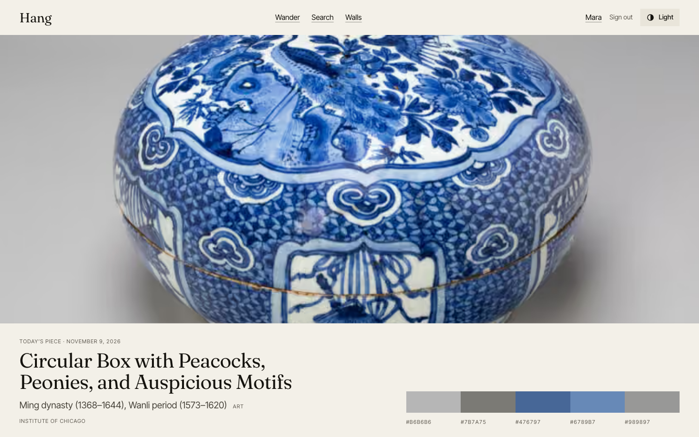
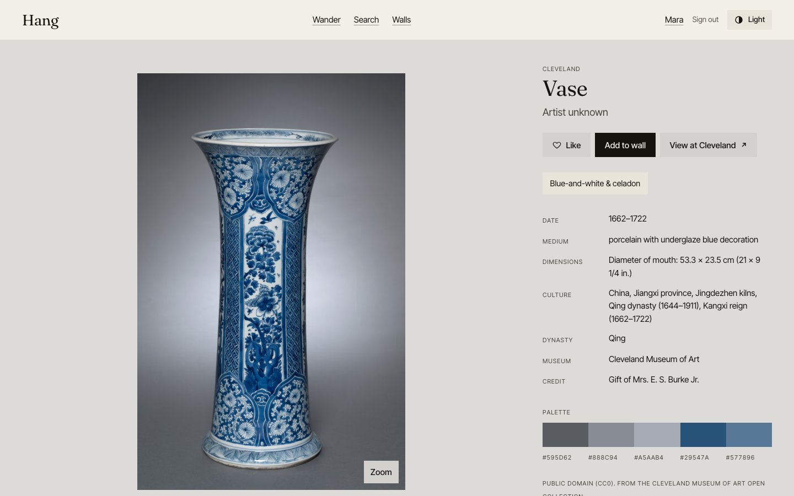
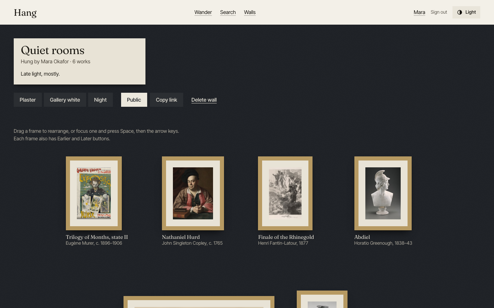
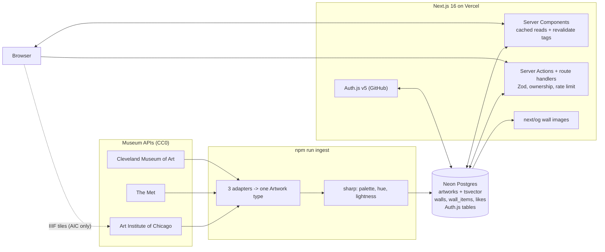

# Hang

**Live site:** https://hang-dusky.vercel.app · **Code:** https://github.com/bhavishyabondalapati/hang



## What it does

Hang is a collection of **Chinese art** to look at slowly, then hang. It gathers public-domain (CC0) works from the Cleveland Museum of Art, the Art Institute of Chicago and the Met into one searchable collection: dragons, ink landscapes, bird-and-flower paintings, blue-and-white and celadon porcelain, jade, silk and embroidery, calligraphy and bronzes. Anyone can browse and search. Signed-in users build **walls** (curated collections), arrange them like a real gallery wall, and share them with a public link.

| | |
|---|---|
|  |  |

## Features

- **Today's piece**: a full-bleed daily artwork (deterministic per date) with a slow Ken Burns zoom and its five-colour palette. It is drawn only from dragons (robes, paintings, jars), ink landscapes, bird-and-flower paintings and porcelain, and only from works with a good image size. Tall works (robes, vases, scrolls) are shown whole on their own palette colour instead of being cropped.
- **Wander**: a masonry grid with infinite scroll, staggered fade-in, and no layout shift (aspect ratios come from the database).
- **Search**: Postgres full-text search with prefix matching, filter chips for **Theme** (eight themes), **Dynasty** (Shang, Zhou, Han, Tang, Song, Yuan, Ming, Qing, Republic period), museum, medium and orientation, and a 12-swatch colour picker (nearest hue). All state lives in the URL, so every search is shareable.
- **Artwork page**: the page tints itself from the work's palette. True deep zoom with IIIF tiles for the Art Institute, pan/pinch/wheel zoom for the other two museums. A "More in this color" rail. Like and Add to wall. A link back to the museum. On phones the metadata panel becomes a bottom sheet.
- **Walls**: three finishes (plaster, gallery white, night), framed works with a title placard marked by a small cinnabar-red seal square, drag-to-reorder (dnd-kit) with keyboard alternatives, a per-wall Open Graph image, and public or private visibility.
- **Content filter**: works about hell, death, violence or nudity are hidden. A keyword pass reads title, artist, tags, classification and description, and two local image models (an NSFW classifier and CLIP zero-shot) look at the picture. Hidden works vanish from every page and API, and their URL is a 404. Every hidden work is listed with its reason in [`hidden-review.md`](hidden-review.md). The filter is deliberately conservative, so it also hides some harmless works.
- **Accessibility**: skip link, visible focus, descriptive alt text, full keyboard use including wall reorder (Space and arrows, or Earlier/Later buttons), `aria-live` status messages, `prefers-reduced-motion` honoured everywhere, light and dark themes plus a toggle.
- **Security**: CSP that only allows the museum image hosts, HSTS, `X-Frame-Options`, `Referrer-Policy`, `Permissions-Policy`. Every input is validated with Zod. Every mutation checks ownership and is rate limited. No secrets reach the client bundle.

## Architecture



## Data sources and credits

All artwork records and images come from the open-access programs of these museums, used under **CC0 / public domain** terms. Each museum adapter enforces its own gate, so nothing else can enter the database:

- **[Cleveland Museum of Art](https://openaccess-api.clevelandart.org/)**: department "Chinese Art", Open Access (`cc0`) works only.
- **[Art Institute of Chicago](https://api.artic.edu/docs/)**: department "Arts of Asia", place of origin China, `is_public_domain` works only. IIIF images.
- **[The Metropolitan Museum of Art](https://metmuseum.github.io/)**: department "Asian Art", culture containing "China", `isPublicDomain=true` works only.

Works with no image, tiny images, or mostly blank or mostly black photographs are skipped at ingest. Every read path (search, feed, detail, today's piece, rails, walls, sitemap, OG images, likes) additionally goes through one shared condition, `isVisible()` in `src/lib/visibility.ts`: the work must be in the `china` collection (it passed ingestion) and must not be `hidden` by the content filter. Each artwork page shows the museum's own credit line and links back to the museum page.

## Tools and libraries, and why

| Tool | Why |
|---|---|
| Next.js 16 (App Router) | Server Components for fast cached reads, Server Actions for mutations, `next/image`, `next/og`. |
| TypeScript (strict) | Catches shape mistakes between the three museum APIs and the database. |
| Tailwind CSS 4 + CSS variables | Utility layout, with one token system powering light/dark mode and per-artwork tinting. |
| Framer Motion | Enter/exit animation for the Add-to-wall menu and the zoom overlay, with `MotionConfig` honouring reduced motion. Everything else is CSS or the View Transitions API. |
| Neon Postgres + Drizzle ORM | Serverless Postgres with full-text search (`tsvector` + GIN). Drizzle gives typed queries and real SQL migrations. |
| Auth.js v5 (GitHub) | Standard OAuth with database sessions, so every request resolves to a real user row. |
| Zod | One validation layer for forms, route handlers and server actions. |
| sharp | Decodes images server-side to compute palettes and hue/lightness at ingest time. |
| dnd-kit | Accessible drag and drop with built-in keyboard support. |
| OpenSeadragon | Deep zoom over IIIF tiles. |
| Vitest + PGlite | Fast unit tests. PGlite is real Postgres in memory, so ownership tests run the real migrations. |
| Playwright | End-to-end tests against a production build, plus the screenshot script used for design review. |

## File structure

```
.env.example                      placeholder env vars (copy to .env.local)
.gitignore                        ignores env files, build output, node_modules, OS files
.github/workflows/ci.yml          CI: lint, typecheck and unit tests on every push and pull request; the build runs when a DATABASE_URL secret is set
LICENSE                           MIT license for the code
README.md                         this file
drizzle.config.ts                 drizzle-kit configuration
drizzle/0000_init.sql             the initial migration (tables, generated tsvector, indexes)
drizzle/0001_chinese_art.sql      adds dynasty, themes and collection columns with indexes
drizzle/0002_content_filter.sql   adds hidden, hidden_reason, description, tags, classification, screened_at
eslint.config.mjs                 ESLint flat config (next core-web-vitals + typescript)
next.config.ts                    security headers, CSP, image host allow-list
package.json                      scripts and dependencies
playwright.config.ts              E2E config (builds and serves the production app)
postcss.config.mjs                Tailwind 4 PostCSS plugin
tsconfig.json                     TypeScript strict config
vitest.config.ts                  unit test config
docs/                             README screenshots
hidden-review.md                  every hidden work (id, title, reason), written by the filter scripts
e2e/hidden.spec.ts                E2E: hidden works are 404, absent from search/feed/sitemap/daily/walls, cannot be added or liked
e2e/browse.spec.ts                E2E: home, search, detail, zoom, headers, theme, 404, API validation
e2e/helpers.ts                    E2E: mocked sign-in helper
e2e/walls.spec.ts                 E2E: sign in, create wall, add art, reorder, public view, ownership
scripts/ingest.ts                 seeds Postgres with Chinese art from the three museums (idempotent, retry, backoff, theme-balanced, quality-gated)
scripts/prune.ts                  one-off cleanup: removes non-Chinese works and test accounts/walls
scripts/refilter.ts               runs the content filter over stored works (backfill text, keyword pass, image pass)
scripts/hidden-review.ts          writes hidden-review.md from the database
scripts/contact-sheet.ts          review helper: thumbnail grid of the top-scoring works for one image signal
scripts/lib/met-polite.ts         the slow, polite Met API fetcher shared by ingest and refilter
scripts/lib/score-cache.ts        on-disk cache of image-model scores (.cache/, git-ignored)
scripts/migrate.ts                applies SQL migrations to DATABASE_URL
scripts/screenshots.ts            light/dark x mobile/desktop screenshots of every page
scripts/readme-shots.ts           captures the README images
src/auth.ts                       Auth.js config (GitHub, Drizzle adapter, database sessions)
src/db/index.ts                   lazy Neon + Drizzle client
src/db/schema.ts                  tables: auth, artworks, walls, wall_items, likes
src/app/layout.tsx                fonts, theme script, header, footer, metadata
src/app/globals.css               design tokens, type scale, light/dark, wall textures, motion
src/app/page.tsx                  home: today's piece and Wander
src/app/search/page.tsx           server entry for search (reads URL params)
src/app/art/[id]/page.tsx         artwork detail page
src/app/walls/[slug]/page.tsx     wall page (public or owner view)
src/app/walls/[slug]/opengraph-image.tsx  per-wall Open Graph image
src/app/me/page.tsx               your walls, likes, create-wall flow
src/app/signin/page.tsx           sign-in page (GitHub)
src/app/signout/page.tsx          sign-out confirmation
src/app/actions.ts                server actions (wall CRUD, add/remove, reorder, like)
src/app/not-found.tsx             designed 404
src/app/error.tsx                 designed error page
src/app/global-error.tsx          last-resort error page (root layout failures)
src/app/sitemap.ts                sitemap.xml (artworks and public walls)
src/app/robots.ts                 robots.txt
src/app/icon.svg                  favicon
src/app/api/auth/[...nextauth]/route.ts   Auth.js handlers
src/app/api/search/route.ts       GET search
src/app/api/daily/route.ts        GET daily artwork (deterministic per date)
src/app/api/wander/route.ts       GET infinite-scroll feed
src/app/api/art/[id]/route.ts     GET artwork detail
src/app/api/art/[id]/like/route.ts        PUT/DELETE like
src/app/api/art/[id]/state/route.ts       GET viewer state (liked, walls)
src/app/api/walls/route.ts        POST create wall
src/app/api/walls/[id]/route.ts   PATCH/DELETE wall
src/app/api/walls/[id]/items/route.ts     POST/DELETE wall item
src/app/api/walls/[id]/order/route.ts     PUT reorder
src/app/api/test/sign-in/route.ts test-only sign-in (404 unless E2E_AUTH=1)
src/components/*                  UI: header/footer, theme toggle, cards, hero, viewer, zoom, wall, forms
src/lib/adapters/{aic,met,cma}.ts one adapter per museum -> shared Artwork type
src/lib/artwork.ts                Artwork type, ids, century/medium/orientation helpers
src/lib/content-filter.ts          keyword pass: terms, whole-word matching, narrow benign-context checks
src/lib/image-filter.ts           image pass decision logic: labels, thresholds, NSFW + CLIP scores to hide/keep
src/lib/image-classifier.ts       loads the two local models with transformers.js (scripts only)
src/lib/visibility.ts             the one isVisible() condition every read path uses
src/lib/color.ts                  palette extraction, HSL, hue distance, contrast
src/lib/dynasty.ts                dynasty list and the parser (text first, then year)
src/lib/themes.ts                 the eight themes, ingest search terms, keyword classifier, daily-piece themes
src/lib/ingest-image.ts           sharp image analysis and the quality gate (ingest only)
src/lib/queries.ts                cached reads: search, wander, daily, detail, walls
src/lib/services/walls.ts         all mutations: validation, ownership, rate limit
src/lib/validation.ts             Zod schemas
src/lib/rate-limit.ts             sliding-window limiter
src/lib/retry.ts                  fetch with retry/backoff, concurrency helper, stable hash
src/lib/errors.ts, api.ts, blur.ts, slug.ts   small shared helpers
tests/*.test.ts                   unit tests (adapters, dynasty/themes/quality, content filter, image filter, color, retry, queries, services, actions)
tests/fixtures/*.json             recorded museum API responses
tests/helpers/db.ts               in-memory Postgres for tests
```

## Setup

You need [Anaconda](https://www.anaconda.com/) (used here only to provide Node), a [Neon](https://neon.tech) database, and a GitHub OAuth app.

```bash
# 1. conda environment named after the project (Node comes from conda-forge)
conda create -n hang -c conda-forge nodejs=22
conda activate hang

# 2. install packages and the browser used for E2E tests
npm install
npx playwright install chromium

# 3. configure secrets
cp .env.example .env.local   # then fill in the four values
```

`.env.local` needs `DATABASE_URL`, `AUTH_SECRET` (`npx auth secret` makes one), `AUTH_GITHUB_ID` and `AUTH_GITHUB_SECRET`. For local sign-in, create a GitHub OAuth app with callback URL `http://localhost:3000/api/auth/callback/github`.

```bash
# 4. create the tables and load artworks
npm run db:migrate
npm run ingest            # ~250 works per theme; re-run any time, it resumes and only adds what is missing
```

## How to run it

```bash
npm run dev               # http://localhost:3000
```

```bash
npm run lint              # ESLint
npm run typecheck         # tsc --noEmit
npm test                  # unit tests (Vitest)
npm run test:e2e          # Playwright (builds and serves the app on :3100)
npm run build             # production build
```

### The content filter

```bash
npm run refilter                          # keyword + image pass on works not yet screened
npm run refilter -- --phase images        # image pass only; re-tuning thresholds is instant (scores are cached)
npm run refilter -- --phase text --recheck   # re-run the keyword rules on stored text (after editing the list)
npm run review                            # rewrite hidden-review.md
RUN_MODEL_TESTS=1 npm test                # also runs the real-model test (downloads the models once)
```

The models run locally in Node (transformers.js, ONNX): `AdamCodd/vit-base-nsfw-detector` and `Xenova/clip-vit-base-patch32`. No API keys; the weights download from the Hugging Face hub on first use. `npm run ingest` applies the same filters to every new work, and `-- --dry` runs everything without writing. To bring a hidden work back, set `hidden = false` on its row.

`npm run ingest -- --target 200 --only cma,aic` is handy for a small test seed. Add `--force` to re-analyse works that are already stored. After switching an older database to Chinese art, `npm run prune` (`npx tsx scripts/prune.ts --dry` to preview) removes the leftover non-Chinese works and test accounts.

## How it was built

1. Planned the build in steps, scaffolded Next 15, strict TypeScript, Tailwind, lint and test configs.
2. Modelled the data in Drizzle: Auth.js tables, `artworks` with a generated `tsvector` column and indexes, `walls`, `wall_items`, `likes`. Generated and applied a migration.
3. Recorded real API responses as fixtures and wrote one adapter per museum, with tests.
4. Wrote the ingestion script (retry with backoff, concurrency limit, sharp palette and hue/lightness, upsert so it is idempotent).
5. Built the cached query layer: full-text search, filters, nearest-hue search, daily artwork.
6. Added Auth.js with GitHub, then the services layer (Zod, ownership, rate limiting), server actions and route handlers, with tests that run against in-memory Postgres.
7. Designed and built the UI: tokens, type, light/dark, home, search, artwork page, walls, `/me`, error pages.
8. Ran the app, took screenshots of every page (light/dark, mobile/desktop), critiqued them, fixed what was off, and repeated.
9. Wrote Playwright E2E tests, ran Lighthouse, tightened accessibility and performance.
10. Narrowed the collection to Chinese art: gated each adapter to its Chinese department, added dynasty and theme fields (parsed from museum wording), replaced the century filter with Dynasty and Theme, made the ingest balance by theme with an image-quality gate, restricted today's piece to on-theme works, and moved the accent to cinnabar red.
11. Built the content filter: a `hidden` flag honoured by every read path, a keyword pass over the museums' text, and a local image pass (NSFW classifier + CLIP), calibrated against contact sheets of the real scores, with a human-readable review list.
12. Upgraded from Next 15 to Next 16 (which also cleared a high-severity `postcss` advisory), moved ESLint to Next's flat config, and fixed the two components the stricter React lint rules flagged.

## Key concepts

- **Normalizer / adapter pattern.** Three APIs with different shapes become one `Artwork` type at the edge, so everything downstream is museum-agnostic.
- **Idempotent ingestion.** Upserts by stable id plus skip-if-present means re-running is safe, which matters when a museum rate-limits you.
- **Retry with exponential backoff and jitter.** The standard way to be a polite API client; it honours `Retry-After`.
- **Postgres full-text search.** A generated `tsvector` with weights (title > artist > culture > medium) and a GIN index. Prefix queries (`van:*`) make results appear while typing.
- **Dynasty parsing.** Museums write dynasties as free text ("Qing dynasty (1644–1911), Yongzheng reign"). The parser reads the museum's own wording (never the title: "Song" and "Han" are ordinary words), prefers the earliest mention, recognises reign names, and only falls back to the year when no dynasty is named. If a period outside the nine is named (Jin, Liao, Sui ...) it leaves the field empty rather than guess.
- **Theme classification.** Keyword rules over title, medium, classification and tags, with guard rails (an "ink landscape" must be a painting, not a vase; a silk-painted fan is not a textile). A work can have several themes.
- **Defence in depth for what is shown.** Adapters only accept the right department and licence; ingest rejects tiny and blank images and runs the content filter; and every query goes through one shared `isVisible()` condition, so one layer failing cannot surface a wrong work.
- **Zero-shot image classification.** CLIP scores an image against text labels with no training. The scores are one probability distribution over all labels, so a label set needs neutral labels describing what the collection really contains, or ordinary objects get squeezed into the unwanted ones. Thresholds were chosen by looking at contact sheets of the top scorers, not guessed.
- **Precision versus recall.** A "when in doubt, hide" filter trades harmless works for safety. The review file and a `hidden` flag you can flip make that trade visible and reversible.
- **Colour search.** Hue is circular (350 and 10 are 20 apart), so distance wraps around 360. Neutral works are excluded by a saturation floor.
- **Authorization at the service layer.** Every mutation goes through one function that checks the session, validates input, rate limits, and verifies ownership, so server actions and REST handlers can't disagree.
- **Server vs client components.** Pages are server-rendered and cached; the session is read client-side so pages stay cacheable.
- **Layout shift.** Width and height are stored, so every image box has the right aspect ratio before it loads. Blur placeholders use the dominant colour.
- **View Transitions API.** The grid thumbnail and the detail image share a `view-transition-name`, which gives the shared-element morph with almost no JavaScript.
- **Testing real Postgres.** PGlite runs the actual migrations in memory, so ownership tests exercise real SQL.

## Notes on this build

- **Collection size.** 1,757 works were ingested; the content filter hides 134 of them (100 by keywords, 34 by the image models), leaving **1,623 visible**: Cleveland 735, Art Institute 416, Met 472. That is short of the original ~2,000 goal and was not refilled. By theme (a work can have several): dragons 262, ink landscapes 268, bird-and-flower 230, blue-and-white & celadon 297, jade 267, calligraphy 256, bronzes 229, silk & embroidery 182. Bronzes lost the most (52 hidden), mostly from descriptions mentioning tombs, burial, warfare or "monster masks" (the *taotie* motif). Silk & embroidery is the thin one: Cleveland's and the Art Institute's Chinese departments hold almost no textiles, so it is nearly all Met.
- **The filter over-hides on purpose.** Most keyword hits are literal matches in museum descriptions ("found in a tomb", "weapon of warfare", "monster mask"), and many image-model hits are false alarms on jade tools and ink paintings. Read `hidden-review.md`; it shows the matched text or the score for every work.
- **Met images are smaller.** The Met's web images top out around 600px, so its works look softer in the grid and detail view than Cleveland's and the Art Institute's. Deep zoom uses the Met's original.

- **Lighthouse (mobile, simulated throttling, production build, after the switch to Chinese art):** home 94, artwork page 93. Accessibility, best practices and SEO score 100. Performance varies a little run to run.
- **Met politeness.** The Met's API is fronted by a bot filter that blocked this machine's IP once before. The Met collector now runs strictly one request at a time at about one per second, waits out a block at most twice, and gives up instead of pushing. Re-running `npm run ingest -- --only met` resumes where it left off.
- **Rate limiting** is in memory per server instance. It resets when an instance is recycled, so it is friction against abuse, not a strict global limit; a shared store (for example Upstash) is the upgrade path.

## Deploy to Vercel

1. Push this repo to GitHub and import it in Vercel (framework: Next.js; defaults are fine).
2. Add these environment variables (Production and Preview):

   | Name | Value |
   |---|---|
   | `DATABASE_URL` | your Neon connection string (pooled, `sslmode=require`) |
   | `AUTH_SECRET` | a long random string (`npx auth secret`) |
   | `AUTH_GITHUB_ID` | GitHub OAuth client ID |
   | `AUTH_GITHUB_SECRET` | GitHub OAuth client secret |
   | `NEXT_PUBLIC_SITE_URL` | your production URL, e.g. `https://hang.vercel.app` (used by the sitemap and OG tags) |

3. **Update the GitHub OAuth app**: set the Authorization callback URL to
   `https://<your-domain>/api/auth/callback/github` (and the Homepage URL to `https://<your-domain>`). Use a separate OAuth app for local development, since a GitHub app has one callback URL.
4. Run the migration and the ingest once against the production database (from your machine, with that `DATABASE_URL` in `.env.local`): `npm run db:migrate && npm run ingest`.
5. Do **not** set `E2E_AUTH` on Vercel. The test sign-in route also refuses to run when NODE_ENV is production, so it is always off on Vercel.

## License

The code in this repository is released under the [MIT License](LICENSE). Copyright (c) 2026 Bhavishya Bondalapati.

MIT covers the code only. Artwork images and records are not stored in this repository (apart from a few recorded API responses used as test fixtures). They are public domain / CC0 and belong to the open-access programs of the museums credited above.
